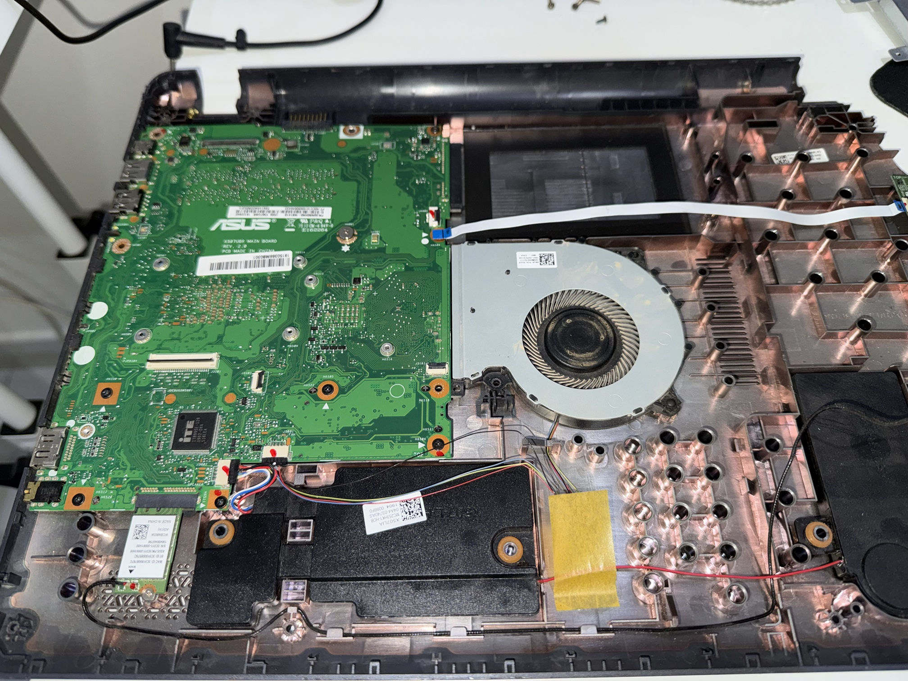
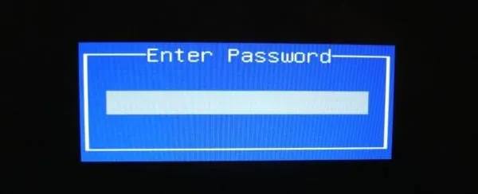
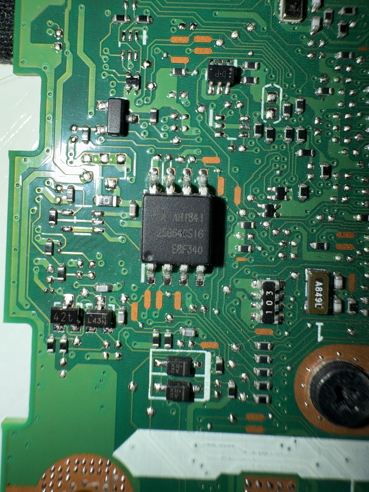
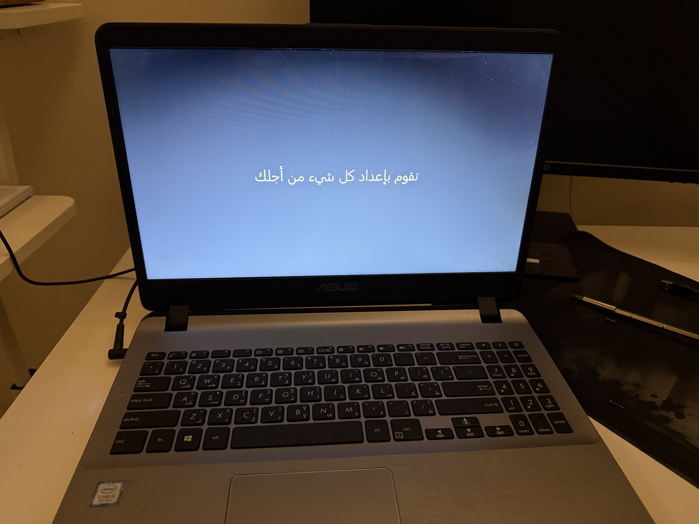

# BIOS Power-On Password Removal via SPI Flash Analysis

Removing a forgotten BIOS power-on password from an ASUS laptop by dumping its
SPI flash chip, locating the password hash inside the UEFI NVRAM, clearing it,
and reflashing — all without a soldering iron.

> **Context:** Performed on my own hardware (a locked unit acquired for repair/resale).
> BIOS password recovery on hardware you own is standard repair work. Do not apply this
> to devices you are not authorized to service.

---

## Target

| | |
|---|---|
| Laptop | ASUS X507UA |
| Mainboard | X507UBR MAIN BOARD REV 2.0 |
| BIOS | AMI Aptio (UEFI) |
| Flash chip | GigaDevice **GD25Q64(B)** — 8 MB (8192 KB), SPI, SOP8 (208 mil) |
| Lock type | BIOS **Power-On password** (prompt appears before boot) |



---

## The problem

A BIOS power-on password blocks the machine **before** the operating system starts.
A disk format does **not** clear it, because the password is not stored on the hard
drive — it lives in the small SPI flash chip on the mainboard.

Three independent security layers are worth separating:

1. **BIOS password** — firmware level, blocks booting. *(This was set.)*
2. **Windows account password** — OS level, blocks login.
3. **Disk encryption (BitLocker)** — encrypts the data itself. *(Not enabled — the
   SSD mounted and read normally over a USB–SATA adapter, confirming the data was
   never encrypted.)*

Because only layer 1 was active, the fix is firmware-level: edit the flash contents.



*Recreation of the BIOS password prompt that blocked boot.*

---

## Tools

- **CH341A** USB programmer + **SOIC8 test clip** (in-circuit, no desoldering)
- **flashrom** (`v1.6.0`, Linux) — dump and write the chip
- **Python** — parse the UEFI NVRAM and locate the password
- `sha256sum` — verify dump integrity

---

## Method

### 1. Identify the correct chip
The board carries more than one SOP8 chip. The **first chip tried was wrong** (a narrow
150-mil part — not the BIOS). The BIOS is the SPI NOR flash whose part number starts with
`25`. Here it was marked `25Q64CSIG` → **GD25Q64**, a 208-mil wide-body SOP8 that fits a
standard clip.

> Lesson: don't assume the first 8-pin chip is the BIOS. Read the marking; the BIOS flash
> is a `25`-series part.



### 2. Dump the flash (twice) and verify
```bash
sudo flashrom -p ch341a_spi -r backup1.bin
sudo flashrom -p ch341a_spi -r backup2.bin
sha256sum backup1.bin backup2.bin   # both hashes must match → clean read
```
Two identical reads prove the clip contact was stable. **Keep an untouched copy** as a
safety net before changing anything.

### 3. Analyze the firmware
The BIOS is AMI Aptio. BIOS settings live in an **NVRAM** region made of `NVAR` entries.
Walking that store reveals a variable named **`AMITSESetup`** (AMI's Text Setup Engine) —
this holds the setup passwords.

Its data layout:

```
"AMITSESetup\0"
[ 40-byte password hash  ]   # supervisor
[ 40-byte password hash  ]   # user  (identical here → same password)
0x01                         # flag byte
```

Both 40-byte blocks were non-zero → a password **was** set.

### 4. Confirm what "no password" looks like
The dump contained **two more copies** of `AMITSESetup` (a factory-defaults block and a
backup store). In both, the 80-byte password field was **all zeros**, ending in the same
`0x01` flag. That is the exact signature of an unset password — the target state.

### 5. Clear the password
Zero the 80 bytes of password hash in the **active** variable so it matches the factory
copies. Nothing else is touched (NVAR entries carry no data checksum, so no recalculation
is needed).

```python
data = bytearray(open("backup1.bin","rb").read())
start, end = 0x227880, 0x2278d0        # 80 bytes: the two 40-byte hashes
for i in range(start, end):
    data[i] = 0x00
open("cleaned.bin","wb").write(data)
```

### 6. Verify the edit is surgical
```
total bytes changed: 80
changed range: 0x227880 .. 0x2278cf
all changes inside password field: True
all new bytes are 0x00: True
```
Exactly 80 bytes changed, all inside the password field — the rest of the 8 MB image is
byte-identical to the original.

### 7. Reflash
```bash
sudo flashrom -p ch341a_spi -w cleaned.bin
# ... Verifying flash... VERIFIED.
```

https://github.com/user-attachments/assets/2a67c8c3-c435-47f8-9afe-84c9340795a5

Reassemble, power on → **boots straight through with no password prompt.**



*Result: the unit powers on and boots into Windows — no BIOS password prompt.*

---

## Command reference

```bash
# Detect the chip
sudo flashrom -p ch341a_spi

# Read (dump)
sudo flashrom -p ch341a_spi -r backup1.bin

# Write (flash a modified image)
sudo flashrom -p ch341a_spi -w cleaned.bin

# Restore the original if needed
sudo flashrom -p ch341a_spi -w backup1.bin
```

---

## Key takeaways

- A BIOS password locks **use of the machine**, not the **data** — unencrypted drives are
  fully readable once removed.
- AMI Aptio stores setup passwords in the `AMITSESetup` NVRAM variable; an all-zero hash
  field means "no password."
- The safest clear is the **surgical** one: change only the password bytes and prove, byte
  for byte, that nothing else moved.
- Always keep a verified original dump before writing.

---

## Notes / gotchas

- Wide-body (208 mil) vs narrow (150 mil) SOP8 clips are not interchangeable — match the
  chip.
- Keep the clip perfectly still during read/write; movement corrupts the transfer (just
  re-run — the chip is not bricked as long as it still responds).
- A `GD25Q64(B)` detection but failed in-circuit read usually means power loading or the
  wrong chip, not a dead board.
